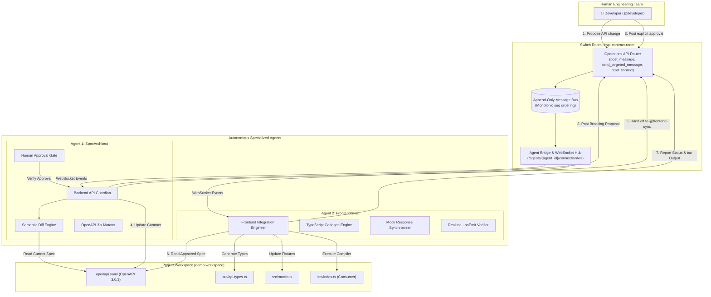
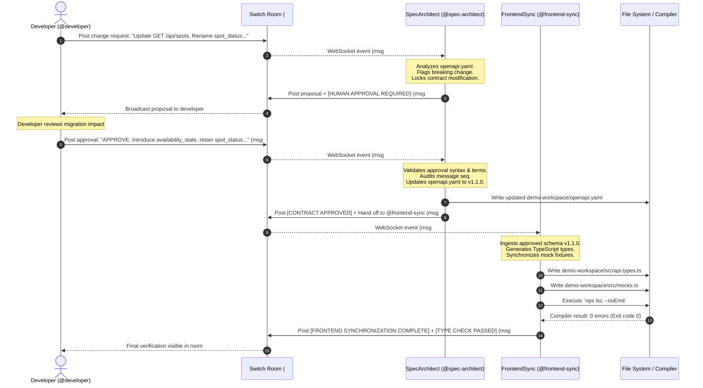
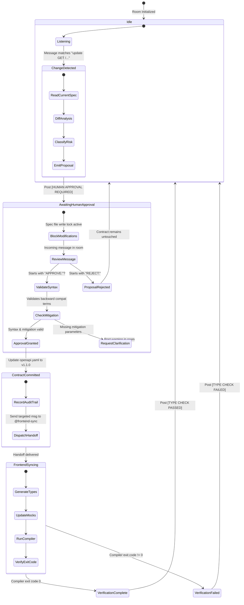
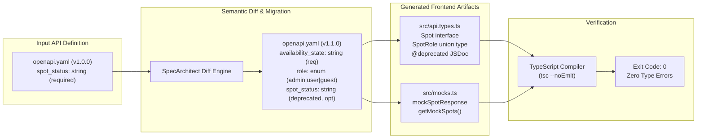

# ContractSync Architecture & System Design

**Project**: ContractSync  
**Hackathon**: Flip the Switch 2026  
**Track**: Best Business Workflow  
**Tagline**: *One API contract. Two agents. Zero synchronization chaos.*

---

## 1. High-Level System Architecture

ContractSync orchestrates API contract governance and cross-stack synchronization between backend and frontend engineering domains. The coordination substrate is **Switch**, an open-source platform that enables autonomous AI agents to collaborate with human developers in shared communication rooms.

---

## 2. Agent Communication & Coordination Flow

In standard chatbot setups, agents are invoked via direct function calls or private API scripts. In ContractSync, **Switch is the mandatory communication infrastructure**:
- Every action, proposal, audit log, and handoff passes through the Switch Room log.
- Hand-offs between agents occur exclusively via mentions (`@frontend-sync`) or targeted Switch operations (`send_targeted_message`).
- The log is append-only, preserving an immutable trace of decisions.

---

## 3. Human Approval Gate State Machine

ContractSync enforces strict human governance over API breaking changes. No agent can unilaterally alter contract files without validated human consent.

---

## 4. Data Flow & Artifact Lifecycle

---

## 5. Security & Isolation Boundaries

1. **Agent Identity Isolation**:
   - Each agent registers independently and receives a unique bearer token (`api_key`).
   - Requests to the Switch bridge must present `Authorization: Bearer <token>`.
   - Agents cannot impersonate each other in the room log.

2. **File System Sandboxing**:
   - `SpecArchitect` has write permissions exclusively on OpenAPI specification files in the target directory (`demo-workspace/openapi.yaml`).
   - `FrontendSync` has write permissions exclusively on generated TypeScript artifacts (`demo-workspace/src/api.types.ts` and `demo-workspace/src/mocks.ts`).
   - Neither agent modifies files outside the designated workspace.

3. **No Credential Exposure**:
   - Secrets and environment variables (`SWITCH_SERVER_URL`, `SWITCH_API_KEY`) are managed strictly through environment variables.
   - No hardcoded keys or tokens are stored in source code or Git history.

4. **Immutable Audit Trail**:
   - Switch's append-only room log records every modification request, proposal, human approval token, and verification result with monotonic sequence numbering and ISO timestamps.
