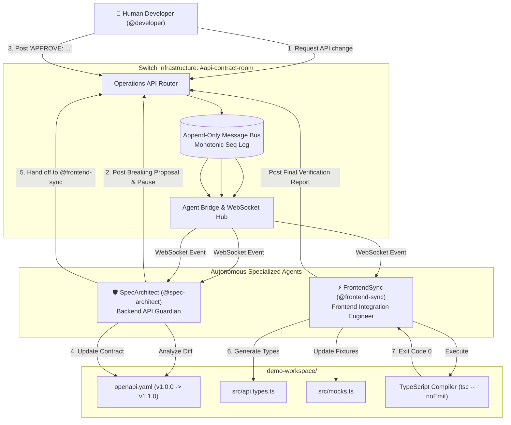

# ContractSync

> **One API contract. Two agents. Zero synchronization chaos.**

[](https://www.wemakedevs.org/hackathons/switch)
[](https://www.wemakedevs.org/hackathons/switch)
[](https://manishr075.github.io/contractsync/)
[](https://github.com/manishr075/contractsync/actions/workflows/deploy.yml)
[](tests/run-all-tests.ts)
[](https://docs.switchagents.ai/)
[](https://www.typescriptlang.org/)

**Live GitHub Pages Showcase & Interactive Simulator:** [https://manishr075.github.io/contractsync/](https://manishr075.github.io/contractsync/)

ContractSync is an autonomous, collaborative API contract coordination and synchronization system built for the **Flip the Switch 2026 Hackathon (Best Business Workflow Track)**.

It pairs two specialized AI agents—**SpecArchitect** and **FrontendSync**—collaborating with a human developer in a shared **Switch** room (`#api-contract-room`) to safely evolve API contracts, prevent breaking changes, maintain backward compatibility, and synchronize frontend TypeScript types and mock fixtures with real compiler verification.

---

## 1. Problem Statement

In modern software organizations, backend and frontend teams frequently suffer from **API contract drift**:
- A backend developer updates an endpoint or renames a field in an OpenAPI specification.
- Frontend TypeScript interfaces, mock handlers, and UI components remain out of sync.
- Applications break silently at runtime in staging or production.
- Developers spend hours in meetings, manual Slack threads, and debugging sessions reconciling type mismatches.

### Why Existing Solutions Fail
- **Static linters** only check syntax, not backward compatibility or frontend impact.
- **Isolated chatbots** lack persistent shared room context, cannot participate in real team workflows, and cannot coordinate multi-agent handoffs.
- **Uncontrolled auto-codegen** blindly introduces breaking changes into frontend codebases without human oversight.

---

## 2. The Solution: ContractSync

ContractSync bridges backend and frontend domains with a **Human-in-the-Loop (HITL)** governance workflow powered by **Switch**:

1. **SpecArchitect** (Backend API Guardian):
   - Ingests API modification requests in the Switch room.
   - Performs semantic diff analysis against the active OpenAPI specification.
   - Identifies breaking changes (e.g. field renames, removals) and calculates consumer risk.
   - Proposes a backward-compatible migration plan (e.g., introducing the new field while retaining the previous field as deprecated and optional).
   - **Enforces an immutable Human Approval Gate**—strictly blocking file modifications until explicit human authorization is recorded.

2. **Human Developer**:
   - Reviews the breaking change analysis and proposed migration in the Switch room.
   - Approves, amends, or rejects the migration.

3. **FrontendSync** (Frontend Integration Engineer):
   - Receives the approved contract handoff through Switch.
   - Regenerates TypeScript types (`src/api.types.ts`) preserving `@deprecated` annotations.
   - Synchronizes mock data fixtures (`src/mocks.ts`) with realistic payloads.
   - Executes real compiler validation (`npx tsc --noEmit`) and posts the live compiler verification report in the Switch room.

---

## 3. Why Switch is Essential

Switch is not a decorative chat integration; **Switch is the mandatory coordination infrastructure**:
- **Shared Context**: Both agents and human developers share the exact same room context (`#api-contract-room`), eliminating out-of-band communication.
- **Append-Only Event Log**: Every change proposal, risk evaluation, and human approval is cryptographically committed with a monotonic sequence number (`seq`), creating a tamper-proof audit trail.
- **Protocol-Native Agent Handoff**: Agents hand work to each other strictly through Switch WebSocket event frames and operation dispatches (`send_targeted_message` / mentions in `post_message`). Direct inter-process function calls are prohibited.
- **No Vendor Lock-in**: Conforms to the official Switch Agent Protocol wire specification, enabling deployment in local workspaces, self-hosted Switch servers, or corporate messaging apps (Slack, Discord, MS Teams).

---

## 4. System Architecture



---

## 5. Technology Stack

- **Coordination Infrastructure**: [Switch AI](https://docs.switchagents.ai/) (Switch Rooms, Agent Bridge WebSocket protocol, Operations API, Switch 0.31 room templates)
- **Language & Runtime**: Node.js (v20+ LTS) & TypeScript (v5.9+ strict mode)
- **API Specification**: OpenAPI 3.0.3 (YAML parsing & AST manipulation via `yaml`)
- **Type Generation**: Deterministic TypeScript AST generator adhering to `openapi-typescript` schema mappings
- **Compiler Verification**: Real TypeScript Compiler (`tsc --noEmit`)
- **Transport**: Native WebSockets (`ws`) and HTTP JSON-RPC operations

---

## 6. Repository Structure

```text
flowguard/ (ContractSync)
│
├── agents/
│   ├── spec-architect/
│   │   ├── instructions.md       # System prompt & operational guidelines
│   │   ├── agent.ts              # SpecArchitect Switch agent runner
│   │   └── analyzer.ts           # Semantic diff engine & approval validator
│   │
│   └── frontend-sync/
│       ├── instructions.md       # System prompt & operational guidelines
│       ├── agent.ts              # FrontendSync Switch agent runner
│       └── sync-engine.ts        # Codegen, mock sync & compiler runner
│
├── switch/
│   ├── room-instructions.md      # Instructions loaded into #api-contract-room
│   ├── approval-protocol.md      # Human-in-the-Loop state machine & rules
│   ├── template.yaml             # Switch 0.31 Room Template definition
│   └── integration/
│       ├── switch-server.ts      # Switch server & Agent Bridge WebSocket server
│       ├── switch-client.ts      # Switch agent client wire protocol
│       └── types.ts              # Protocol frame types & operation schemas
│
├── demo-workspace/               # Real consumer workspace
│   ├── openapi.yaml              # Managed API contract (Spot Service)
│   ├── package.json              # Frontend consumer workspace config
│   ├── tsconfig.json             # Strict TypeScript configuration
│   └── src/
│       ├── api.types.ts          # Synchronized TypeScript interfaces
│       ├── mocks.ts              # Synchronized mock fixtures
│       └── index.ts              # Consumer application component
│
├── scripts/
│   ├── run-demo.ts               # Complete 7-step autonomous scenario runner
│   ├── run-switch-server.ts      # Standalone Switch Room server
│   ├── generate-types.ts         # Direct type generation utility
│   ├── verify-contract.ts        # Direct compiler verification utility
│   └── query-switch-docs.mjs     # Live Switch docs MCP query client
│
├── tests/
│   ├── run-all-tests.ts          # Master test suite runner
│   ├── 1-openapi-validity.test.ts
│   ├── 2-field-rename-detection.test.ts
│   ├── 3-enum-detection.test.ts
│   ├── 4-backward-compatibility.test.ts
│   ├── 5-type-generation.test.ts
│   ├── 6-mock-data-consistency.test.ts
│   ├── 7-typescript-compiler.test.ts
│   ├── 8-unapproved-modification-rejection.test.ts
│   ├── 9-invalid-approval-handling.test.ts
│   └── 10-switch-wire-protocol.test.ts
│
├── .env.example
├── .gitignore
├── package.json
├── README.md
├── ARCHITECTURE.md
└── DEMO_SCRIPT.md
```

---

## 7. Installation & Quickstart

### Prerequisites
- Node.js v18+ (tested on Node v20 LTS)
- npm v9+

### Setup
```bash
# 1. Clone repository
git clone <repo-url> contractsync
cd contractsync

# 2. Install dependencies
npm install

# 3. Configure environment
cp .env.example .env
```

---

## 8. Running the Live Demonstration

To execute the complete 7-step scenario through the Switch Room:

```bash
npm run demo
```

### What You Will See:
1. **Switch Server & Agent Bridge** boots on port `8799` and initializes `#api-contract-room`.
2. **SpecArchitect** and **FrontendSync** connect over WebSocket, registering their agent identities.
3. **Developer** posts:
   `"Update GET /api/spots. Rename spot_status to availability_state and add a role field with the values admin, user and guest."`
4. **SpecArchitect** detects the breaking change, warns of frontend breakage, proposes backward-compatible migration, and pauses for human approval.
5. Safety check confirms `openapi.yaml` is untouched.
6. **Developer** approves:
   `"APPROVE: Introduce availability_state, retain spot_status as an optional deprecated field for backward compatibility, and add the role enum."`
7. **SpecArchitect** commits `openapi.yaml` (v1.1.0) and notifies **FrontendSync** via Switch.
8. **FrontendSync** regenerates `src/api.types.ts`, updates `src/mocks.ts`, and invokes `npx tsc --noEmit`.
9. The real compiler output (`Exit code 0, 0 errors`) is reported in the Switch room!

---

## 9. Running Automated Tests

Run the complete 10-suite automated test suite:

```bash
npm test
```

### Test Suite Coverage:
| Test ID | Test Name | Focus Area | Status |
| :---: | :--- | :--- | :---: |
| **01** | OpenAPI Specification Validity | OpenAPI 3.0.3 schema compliance | `PASS` |
| **02** | Field Rename Breaking Change Detection | Identifies `spot_status` -> `availability_state` | `PASS` |
| **03** | Enum Addition Detection | Identifies `role: [admin, user, guest]` | `PASS` |
| **04** | Deprecated Backward Compatibility | Verifies `spot_status` is retained & optional | `PASS` |
| **05** | Deterministic Type Generation | Types `Spot`, `SpotRole`, `@deprecated` JSDoc | `PASS` |
| **06** | Mock Data Consistency | Realistic mock payloads with enums | `PASS` |
| **07** | TypeScript Compilation Verification | Real `tsc --noEmit` exit code 0 | `PASS` |
| **08** | Rejection of Unapproved Modifications | Enforces spec write lock before approval | `PASS` |
| **09** | Handling Invalid / Incomplete Approvals | Rejects malformed or incomplete approvals | `PASS` |
| **10** | Switch Wire Protocol Verification | WebSocket frames, seq numbering & operations | `PASS` |

---

## 10. Switch Setup & Integration Options

ContractSync supports two execution modes with Switch:

### Option A: Local Switch Server (Included & Default)
Runs an authentic local Switch Room Server & Agent Bridge compliant with Switch 0.31 specifications (`/agents/{agent_id}/connection/ws`, operations API, append-only seq logs). Ideal for offline development, local demos, and CI/CD pipelines.

```bash
npm run start:server
```

### Option B: Remote / Self-Hosted Switch Deployment
To connect ContractSync to a production Switch server (e.g. integrated with Slack, Discord, or Mattermost):
1. In `.env`, set:
   ```bash
   SWITCH_SERVER_URL=https://your-switch-server.internal
   SWITCH_API_KEY=sw_your_agent_api_key
   SWITCH_ROOM_ID=api-contract-room
   ```
2. Import `switch/template.yaml` into Switch Console or Gateway.
3. Start the agents using `npm run demo`.

---

## 11. Known Limitations & Roadmap

- **REST / OpenAPI Only**: Currently supports OpenAPI 3.x specifications; GraphQL and gRPC schemas are planned for v2.0.
- **Single Room Context**: Currently demonstrates coordination in a single Switch room (`#api-contract-room`). Linked rooms across microservices are supported in the Switch template for future expansion.
- **Git Push Gate**: Changes are applied directly to the working directory. An automated GitHub Pull Request creation bridge can be attached to `@frontend-sync`.

---

## 12. License

Apache-2.0 License. Built with pride for **Flip the Switch 2026**.
