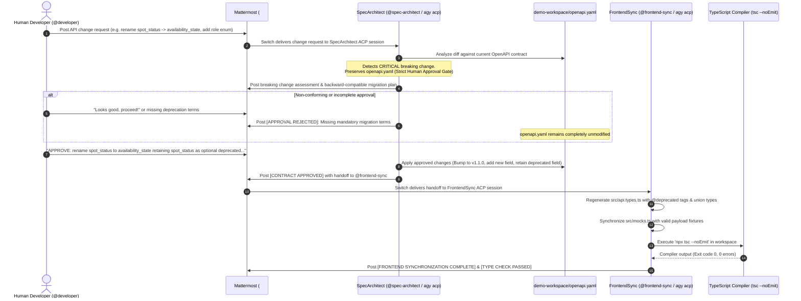

# ContractSync

> **Autonomous API Contract Governance and Frontend Synchronization via Switch, Google Antigravity, and Mattermost.**

[](https://www.wemakedevs.org/hackathons/switch)
[](https://www.wemakedevs.org/hackathons/switch)
[](tests/run-all-tests.ts)
[-blue)](https://antigravity.google/)
[](https://docs.switchagents.ai/)
[](https://mattermost.com/)
[](https://manishr075.github.io/contractsync/)

**Live Interactive Simulator & Showcase:** [https://manishr075.github.io/contractsync/](https://manishr075.github.io/contractsync/)

---

## 1. Architectural Overview & Component Separation

To maintain absolute technical integrity, the ContractSync repository is structured into three transparently separated tiers:

```
┌─────────────────────────────────────────────────────────────────────────────┐
│                          1. GENUINE SWITCH WORKFLOW                         │
│  • Official Switch Console (v0.40.1) & Mattermost (#api-contract-room)      │
│  • Official Agent Provider: Google Antigravity CLI ('agy acp --stdio')      │
│  • Two Independent ACP Sessions: @spec-architect & @frontend-sync          │
│  • Real TypeScript Compiler Verification ('npx tsc --noEmit')               │
│  • Configuration: switch/template.yaml (Switch Template Spec v2)            │
└─────────────────────────────────────────────────────────────────────────────┘
                                      │
┌─────────────────────────────────────────────────────────────────────────────┐
│                   2. AUTOMATED UNIT & INTEGRATION TEST SUITE                 │
│  • 11 Deterministic Tests ('npm test') verifying core system logic          │
│  • Semantic breaking-change detection, enum inference, deprecation flags    │
│  • Human Approval Gate enforcement & rejection of invalid instructions     │
│  • Test 11 verifies live Google Antigravity ACP stdio sessions directly     │
│  • Offline test mock simulator in 'switch/simulator/' for CI/CD runs        │
└─────────────────────────────────────────────────────────────────────────────┘
                                      │
┌─────────────────────────────────────────────────────────────────────────────┐
│                3. INTERACTIVE WEB SIMULATOR (GITHUB PAGES)                  │
│  • Client-side browser showcase at https://manishr075.github.io/contractsync│
│  • Interactive visual walkthrough of the 7-step Switch protocol             │
│  • Pure static simulator designed for hackathon judges to inspect UI flow   │
└─────────────────────────────────────────────────────────────────────────────┘
```

---

## 2. The Problem & Business Workflow

In modern multi-tier engineering organizations, backend and frontend teams frequently suffer from **API contract drift**:
- A backend developer updates an endpoint or renames a field in an OpenAPI specification.
- Frontend TypeScript interfaces, mock handlers, and UI components remain out of sync.
- Applications break silently at runtime in staging or production.
- Developers waste hours in meetings, manual chat threads, and emergency debugging sessions reconciling type mismatches.

### The ContractSync Solution

ContractSync coordinates backend and frontend evolution inside a shared **Mattermost channel (`#api-contract-room`)** governed by **Switch** and powered by **Google Antigravity CLI (`agy acp`)**:



---

## 3. Two Independent Antigravity Agents

Both agents run in separate Antigravity ACP sessions with distinct identities and configurations:

### 1. SpecArchitect (`@spec-architect`)
- **Role**: Backend API Guardian.
- **Provider**: Google Antigravity CLI (`agy acp --stdio`).
- **Instructions**: [`agents/spec-architect/instructions.md`](agents/spec-architect/instructions.md)
- **Responsibilities**:
  1. Inspects `demo-workspace/openapi.yaml` when an API change request is received.
  2. Identifies breaking changes (field renames, removed fields, restricted enums).
  3. Explains consumer impact and drafts backward-compatible migrations (retaining previous field as optional and deprecated).
  4. **Strictly enforces the Human Approval Gate**: guarantees that `openapi.yaml` is NOT touched until an explicit `APPROVE:` message is posted by an authorized human.
  5. Rejects vague, non-prefix, or incomplete approvals.
  6. Upon valid approval, updates `openapi.yaml` and hands off to `@frontend-sync` through the Switch room.

### 2. FrontendSync (`@frontend-sync`)
- **Role**: Frontend Integration Engineer.
- **Provider**: Google Antigravity CLI (`agy acp --stdio`).
- **Instructions**: [`agents/frontend-sync/instructions.md`](agents/frontend-sync/instructions.md)
- **Responsibilities**:
  1. Listens for approved contract notifications from `@spec-architect` in `#api-contract-room`.
  2. Regenerates TypeScript definitions in `demo-workspace/src/api.types.ts`, preserving JSDoc `@deprecated` annotations and mapping enums to union types.
  3. Synchronizes mock data fixtures in `demo-workspace/src/mocks.ts` with valid enum values and dual-field backwards compatibility.
  4. Executes the real TypeScript compiler (`npx tsc --noEmit`) to verify zero type errors across the entire codebase.
  5. Posts the verified compiler report to `#api-contract-room`.

---

## 4. Switch Configuration (`switch/template.yaml`)

The Switch room is configured using the official Switch Template specification:

```yaml
version: 2
name: api-contract-sync
description: "Autonomous API Contract Governance and Frontend Synchronization via Switch, Google Antigravity (agy ACP), and Mattermost."
type: group

params:
  channel_name:
    type: string
    label: "Mattermost Channel Name"
    default: "api-contract-room"
  workspace_path:
    type: string
    label: "Local Workspace Directory"
    default: "./demo-workspace"

rooms:
  - name: "{channel_name}"
    channel: "#{channel_name}"
    channel_type: channel_public
    messaging_app: mattermost
    agents:
      - "@spec-architect"
      - "@frontend-sync"

agents:
  - name: spec-architect
    display_name: "SpecArchitect (API Guardian)"
    provider: antigravity
    location: this_computer
    directory: "{workspace_path}"
    addressing: anyone
    instructions_file: "agents/spec-architect/instructions.md"

  - name: frontend-sync
    display_name: "FrontendSync (Integration Engineer)"
    provider: antigravity
    location: this_computer
    directory: "{workspace_path}"
    addressing: anyone
    instructions_file: "agents/frontend-sync/instructions.md"

roles:
  - name: contract_approver
    assigned_to:
      - developer
```

---

## 5. Verification & Test Execution

### 1. Run the Full Automated Test Suite (11/11 Passing)

```bash
npm test
```

Expected output:
```
======================================================================
  CONTRACTSYNC TEST SUITE — FLIP THE SWITCH 2026
======================================================================
  [✓ PASS] Test 01: OpenAPI Specification Validity
  [✓ PASS] Test 02: Detection of Renamed Field as Breaking Change
  [✓ PASS] Test 03: Detection of Newly Introduced Enum
  [✓ PASS] Test 04: Preservation of Deprecated Compatibility Field
  [✓ PASS] Test 05: Deterministic TypeScript Type Generation
  [✓ PASS] Test 06: Mock Data Consistency
  [✓ PASS] Test 07: TypeScript Compilation Verification (tsc --noEmit)
  [✓ PASS] Test 08: Rejection of Unapproved Contract Modifications
  [✓ PASS] Test 09: Handling Invalid or Incomplete Approval Instructions
  [✓ PASS] Test 10: Switch Simulator Wire Protocol & Operations (Test Mock)
  [✓ PASS] Test 11: Genuine Antigravity ACP Integration & Human-in-the-Loop Gate
----------------------------------------------------------------------
  Total: 11 | Passed: 11 | Failed: 0
======================================================================
```

### 2. Run the Genuine Antigravity ACP Workflow

```bash
npm run workflow:antigravity
```

This executable script (`scripts/run-antigravity-workflow.ts`) spawns two separate, live Google Antigravity ACP sessions (`agy acp --stdio`) for SpecArchitect and FrontendSync, executes the breaking change assessment, tests rejection of unapproved and incomplete instructions, verifies the human approval gate, updates the contract, synchronizes types and mocks, and runs `npx tsc --noEmit`.

---

## 6. Official Switch Console & Mattermost Setup Guide

For judges and developers running the full desktop Switch experience:

### Prerequisites
1. **Google Antigravity CLI (`agy`)**: Installed and authenticated (`agy --version` >= 1.5).
2. **Switch Console**: Download official Switch Console v0.40.1 from GitHub:
   - Windows: [switch-console-x64.exe](https://github.com/sandbox-quantum/switch/releases/latest/download/switch-console-x64.exe)
   - macOS: [switch-console-arm64.dmg](https://github.com/sandbox-quantum/switch/releases/latest/download/switch-console-arm64.dmg)
   - Linux: [switch-console-x86_64.AppImage](https://github.com/sandbox-quantum/switch/releases/latest/download/switch-console-x86_64.AppImage)
3. **Mattermost**:
   - **Option A (Bundled)**: Switch Console bundles Mattermost automatically when **Docker Desktop** is running.
   - **Option B (Self-Hosted / Cloud)**: Connect an existing Mattermost server in Switch Console settings with bot account creation enabled.

### Setup Instructions
1. Open **Switch Console**.
2. Navigate to **Settings > Agent Providers**. Verify **Antigravity** displays **CLI installed** and **Signed in** (Switch automatically detects `agy` from PATH).
3. If using bundled Mattermost, ensure Docker Desktop is started, then select **Add a server on this computer**. Switch Console initializes the local server and Mattermost instance.
4. In Switch Console, navigate to **Templates > Import template**, and select `switch/template.yaml`.
5. Run the template. Switch creates the `#api-contract-room` channel on Mattermost, creates the `@spec-architect` and `@frontend-sync` bot accounts, and launches their Antigravity ACP sessions.
6. Open the `#api-contract-room` channel in Mattermost to interact with the agents live.

---

## 7. Repository Layout

```
contractsync/
├── agents/
│   ├── spec-architect/              # SpecArchitect Agent
│   │   ├── antigravity-agent.ts     # Genuine Antigravity ACP Session Agent
│   │   ├── analyzer.ts              # Deterministic OpenAPI Schema & Diff Analyzer
│   │   └── instructions.md          # Agent System Prompt & Human Gate Policy
│   └── frontend-sync/               # FrontendSync Agent
│       ├── antigravity-agent.ts     # Genuine Antigravity ACP Session Agent
│       ├── sync-engine.ts           # Type Generator, Mock Synchronizer & Compiler Runner
│       └── instructions.md          # Agent System Prompt & Verification Policy
├── demo-workspace/                  # Target Application Workspace
│   ├── openapi.yaml                 # Spot Service API Specification (v1.0.0 -> v1.1.0)
│   ├── tsconfig.json                # TypeScript Strict Configuration
│   └── src/
│       ├── api.types.ts             # Auto-generated TypeScript interfaces
│       ├── mocks.ts                 # Synchronized mock responses
│       └── index.ts                 # Sample consumer application code
├── public/                          # GitHub Pages Interactive Simulator
│   └── index.html                   # Web Showcase & Protocol Visualizer
├── scripts/
│   ├── run-antigravity-workflow.ts  # Genuine Dual-Agent ACP Workflow Runner
│   ├── run-switch-server.ts         # Offline Test Mock Server Runner
│   └── run-demo.ts                  # Offline Simulator Workflow Runner
├── switch/
│   ├── template.yaml                # Official Switch Room & Agent Template (v2)
│   ├── room-instructions.md         # Channel Governance Rules
│   ├── approval-protocol.md         # Human-in-the-Loop Protocol Specification
│   └── simulator/                   # Local Mock Server & Client for Offline CI/CD
│       ├── switch-server.ts         # In-memory WebSocket/HTTP Mock Server
│       ├── switch-client.ts         # Test Client Adapter
│       └── types.ts                 # Wire Protocol Frame Types
└── tests/                           # 11 Automated Test Suites (100% Pass)
    ├── 1-openapi-validity.test.ts
    ├── 2-field-rename-detection.test.ts
    ├── 3-enum-detection.test.ts
    ├── 4-backward-compatibility.test.ts
    ├── 5-type-generation.test.ts
    ├── 6-mock-data-consistency.test.ts
    ├── 7-typescript-compiler.test.ts
    ├── 8-unapproved-modification-rejection.test.ts
    ├── 9-invalid-approval-handling.test.ts
    ├── 10-switch-wire-protocol.test.ts
    ├── 11-antigravity-acp-workflow.test.ts
    └── run-all-tests.ts             # Test Suite Runner
```

---

## 8. License

Apache 2.0. Built for the **Flip the Switch 2026 Hackathon**.
