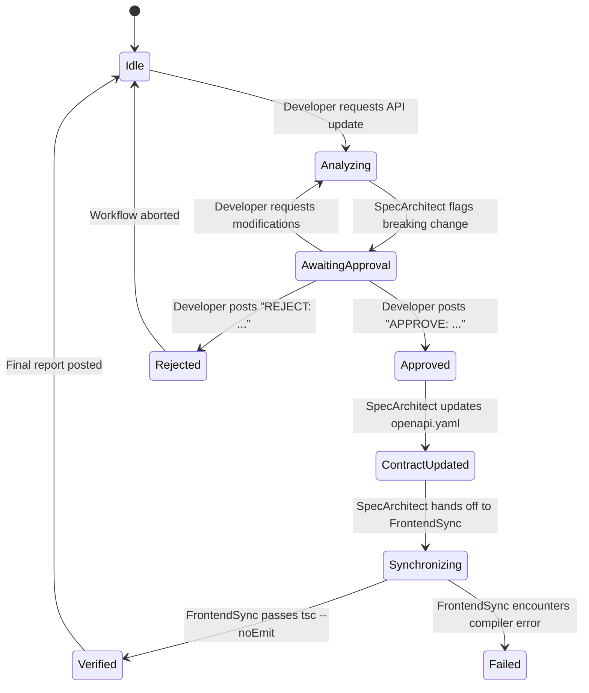

# ContractSync Human-in-the-Loop Approval Protocol

## 1. Overview
The Human-in-the-Loop (HITL) approval protocol guarantees that no automated agent alters production API specifications without explicit, recorded human developer authorization in the shared Switch room.

## 2. State Machine

## 3. Protocol Rules

### Rule 1: Read-Only Analysis Before Authorization
- When an API modification is requested, `SpecArchitect` analyzes the current contract, determines the diff, and categorizes changes as:
  - **Breaking**: Field renames, field removals, type narrowing, required field additions.
  - **Non-Breaking**: Optional field additions, additive enum values.
- `SpecArchitect` must not touch `openapi.yaml` during the analysis phase.

### Rule 2: Explicit Approval Syntax
- The human developer must post a message in `#api-contract-room` starting with the token `APPROVE:` or `APPROVED:`.
- The approval must specify how breaking changes are mitigated (e.g. retaining deprecated compatibility fields).
- Any message not matching the approval criteria keeps the protocol in `AwaitingApproval` state.

### Rule 3: Cryptographic & Audit Traceability
- All approvals are stored in the Switch room's append-only message log with:
  - Sequence number (`seq`)
  - Timestamp (ms)
  - Sender participant id (`@developer:<server>`)
  - Exact approval message body
- `SpecArchitect` references the approval message ID and sequence number when writing the updated contract.

### Rule 4: Switch-Mediated Handoff
- Direct communication between agents outside the Switch room is prohibited.
- `SpecArchitect` signals `FrontendSync` exclusively by posting a message in `#api-contract-room` addressing `@frontend-sync` or dispatching a Switch `send_targeted_message` operation.

### Rule 5: Hard Compiler Verification Gate
- `FrontendSync` is not permitted to declare success based on heuristic checks.
- It must invoke the actual TypeScript compiler (`npx tsc --noEmit`) and verify an exit code of `0`.
- If compilation fails, `FrontendSync` posts `[TYPE CHECK FAILED]` with stdout/stderr compiler logs.
